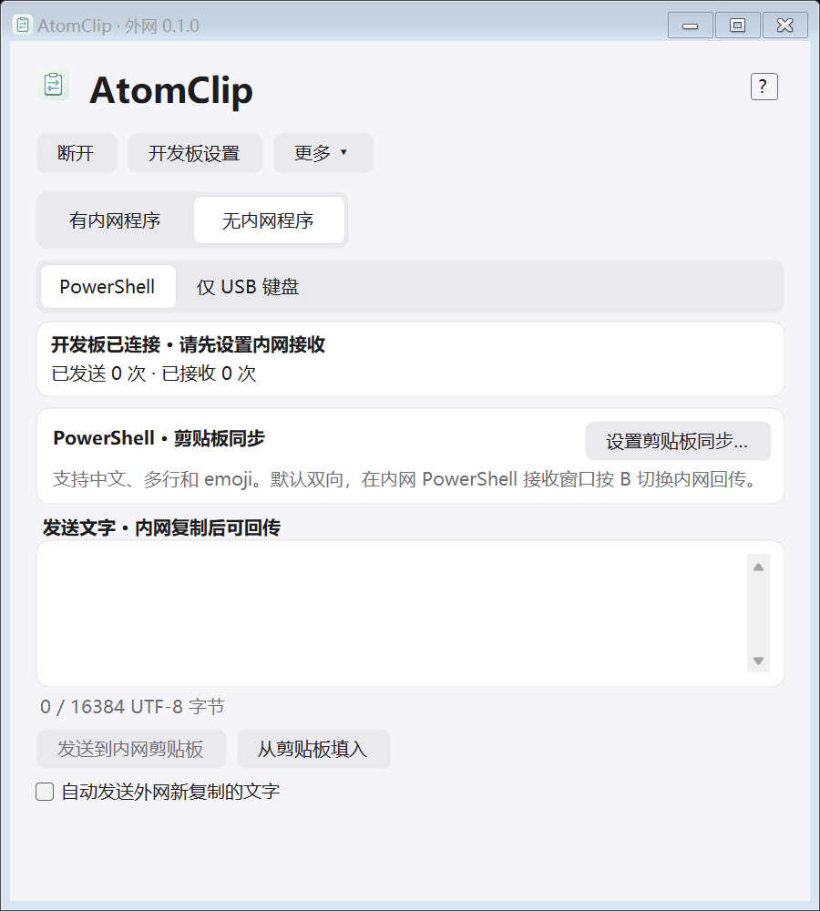
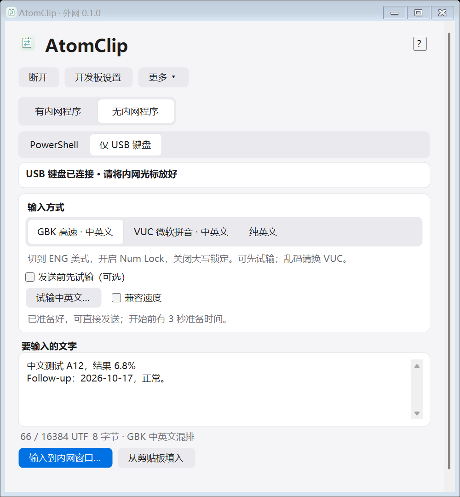

<p align="center"></p>

# AtomClip

通过 **USB + BLE**，在 Windows 内网电脑与外网 Windows / Android 设备之间传递纯文本。

**Windows / Android 0.2.0 · 公开配套** · Windows x64 · Android 8.0+ · AtomS3U / Generic ESP32-S3 SPI NOR

0.2.0 修复部分 Windows 系统蓝牙服务查询报 0x80070016、导入后无法连接的问题；已在用户目标板完成身份认证及加密状态往返。无需重绑或重烧，详见 [修复记录](docs/WINDOWS_BLE_FIX_022.md)。

当前版本为 0.2.0（Android 内部版本码 61）。VUC 默认兼容速度为按键 4ms / 确认等待 80ms，可点击“自定义速度”调整、保存或恢复默认；详情见 [速度更新与验证](docs/VUC_SPEED_020.md)。

[下载 0.2.0 Release](https://github.com/xpump/AtomClip/releases/tag/v0.2.0) · [更新说明](docs/RELEASE_NOTES.md) · [从 0.1.0 升级](docs/MIGRATION.md)。构建与桌面回归已完成；实机验证范围见更新说明。

开发板插在内网电脑，外网设备通过 BLE 连接。不需要 Wi-Fi、云服务或共同服务器；支持中文、英文、换行，剪贴板模式还支持 emoji。



## 选择适合的方式

| 内网条件 | 使用方式 | 传输能力 |
| --- | --- | --- |
| 允许运行内网程序 | 有内网程序 | 双向剪贴板同步；外网可编辑后发送，也可开启复制自动发送 |
| 允许系统 PowerShell、Add-Type 和 USB 串口 | 无内网程序 → PowerShell | 四步设置后默认双向；内网窗口按 **B** 切换回传，**P** 暂停，**Q** 退出 |
| 仅允许 USB 键盘 | 无内网程序 → 仅 USB 键盘 | GBK / VUC 中英文混排、纯英文；单向输入到当前光标位置 |

**仅 USB 键盘不能读取内网剪贴板。** GBK 依赖系统和目标窗口的数字码支持；VUC 依赖已有的微软拼音全拼。两种方式均不支持任意 Unicode，遇到不支持的字符明确拒绝，不静默跳过。

## 功能

- Windows 内网程序保持精简：新增设备配对初始化后为 **60 KiB（61,440 字节）**，不捆绑运行时、固件或烧录工具。
- Windows 外网端内置固件、离线烧录工具与设置向导；新开发板可直接初始化。
- PowerShell 默认双向，窗口内按 B 切换回传，无需为方向重做初始化。
- USB 输入方式直接显示为按钮，保留 GBK 高速、VUC 微软拼音及纯英文；**试输可选**，默认显示正文。
- Android 0.2.0 提供紧凑三页签、全屏编辑、撤销与一键清空；手机可通过 OTG 烧录配套开发板（待实机验证）。
- 浅色分组界面、可滚动布局、分层帮助；文本框在发送完成和模式切换时保留草稿。
- 物理 USB 认领开发板、独立随机控制密钥、完整编号选择与双向认证；配置可通过口令加密导出，在 Windows / Android 间共享。
- AES-GCM、认证回执、重试、去重与暂停；单条最多 **16,384 UTF-8 字节**，超长拒绝，不截断。
- 不保存剪贴板历史；日志只记录状态与字节数，不记录正文或配对信息。



## 开始使用

此仓库提供源码和独立配对构建方法。先按[开发与构建](docs/DEVELOPMENT.md)生成自己的一套程序，再按以下步骤连接。

1. 按[板型筛选](docs/BOARDS.md)确认 ESP32-S3、SPI NOR 4/8/16MB、原生 USB 与匹配配置。在开发板设置中识别并烧录配套固件；首次安装 / 分区不兼容时明确选择清空安装。手机 OTG 下载待实机验证。
2. 重新拔插并保持在外网 USB 正常运行模式，通过“我的开发板 → USB 添加”读取完整编号并绑定。已有可信客户端的绑定可以加密导入。旧版迁移见[升级说明](docs/MIGRATION.md)。
3. 将开发板移至内网，选择已绑定的完整编号连接，再按[使用说明](docs/QUICKSTART.md)选择模式。一次只连接一个外网客户端。不会按名称或信号强弱自动连接未知板。认证失败不会自动降级到旧版。

PowerShell 启动等待默认 10 秒，可设 3–60 秒，慢电脑建议 20–30 秒。界面显示估算范围和已用时间，完成以开发板回执为准。USB 直接输入开始前保留 3 秒准备时间。

## 环境要求

| 组件 | 要求 |
| --- | --- |
| 开发板 | AtomS3U 8MB 或 Generic ESP32-S3 SPI NOR 4/8/16MB；DIO 80MHz、原生 USB、固件不启用 PSRAM；[支持矩阵](docs/BOARDS.md) |
| Windows 外网端 | Windows 10 2004 / build 19041+ 或 Windows 11；x64、.NET Framework 4.8、BLE 适配器 |
| Windows 内网程序 | Windows 10 1903 / build 18362+；x64、.NET Framework 4.8 |
| PowerShell 接收器 | 系统 PowerShell 5.1 / STA、.NET Framework 4.8，允许 Add-Type 与 USB 数据通信 |
| Android | Android 8.0+、BLE；8–11 需定位权限及开关，12+ 需附近设备权限 |

Android 需要保持应用在前台；离开后断开，返回后重连，不补发离线内容。没有跨应用后台剪贴板同步，Android 0.2.0 包含手机 USB OTG 分段烧录（内置四种 S3 板型，待实机验证）。详细范围见 [Android 说明](docs/ANDROID.md)。

仅传输纯文本，不支持图片、文件或富文本。系统接收模式的动态编译组件可能创建临时文件；软件不更改执行策略。GBK / VUC 的目标窗口兼容性和速度需要在实际设备上验证。

## 源码与发布

```text
assets/       图标与可编辑 SVG
src/windows/  Windows 主程序、精简接收端、PowerShell 接收器
src/android/  原生 Android 客户端
src/firmware/ AtomS3U USB / BLE / HID 固件
scripts/      配对生成、构建、测试与打包
tests/        协议、界面、剪贴板及按键规划测试
docs/         使用、构建、发布与验证说明
licenses/     第三方许可
.github/      GitHub Actions 协议互通检查
```

0.2.1 经物理 USB 为每块板添加独立控制绑定，自动保留板上已有正文配对。已保存的绑定再次接入时优先核对，避免重复改绑。客户端通过加密绑定配置共享同一目标。**公开源码包不包含密钥、安卓签名、SDK 或个人配套 EXE / APK / 固件。** 私人迁移套件仍含旧正文配对材料，不得公开；公开配套必须使用单独的公开签名与旧配对材料。

- [使用说明与故障排查](docs/QUICKSTART.md)
- [开发与构建](docs/DEVELOPMENT.md)
- [上传 GitHub 与打包](docs/PUBLISHING.md)
- [Android 功能范围](docs/ANDROID.md)
- [通信协议](docs/PROTOCOL.md)
- [验证记录](docs/VALIDATION.md)
- [版本记录](CHANGELOG.md)
- [配对与隐私](SECURITY.md)

## 验证状态

Windows / Android 编译、APK 签名、桌面协议互通及 Windows 界面回归已有记录；GitHub Actions 已配置。**实际内网目标程序的 HID 兼容性、漏字率以及 Android 真机流程仍待验收**，编译和模拟链路通过不等同于实机通过。

安全绑定需要 0.2.0 或更新固件及一次物理 USB 绑定；已正常绑定的 V2 板无需为本次客户端更新重烧。新版已移除旧固件兼容连接。附近扫描读取完整编号后与本地记录合并，连接仍须通过双向认证。保留旧正文配对时原内网程序可继续使用，详见 [迁移说明](docs/MIGRATION.md)。

自有代码采用 [MIT](LICENSE) 许可；第三方组件遵循各自许可，见[第三方说明](licenses/THIRD_PARTY.md)。
