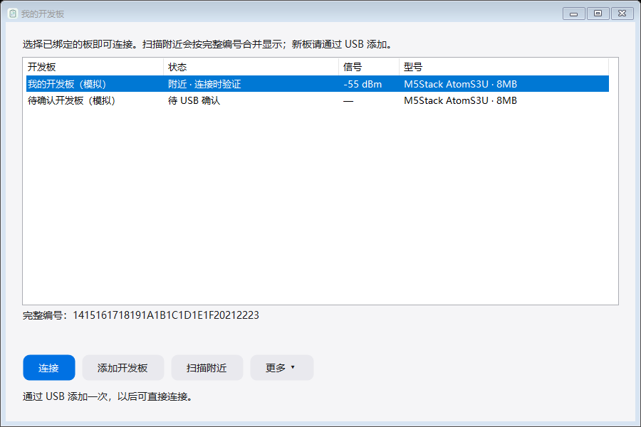
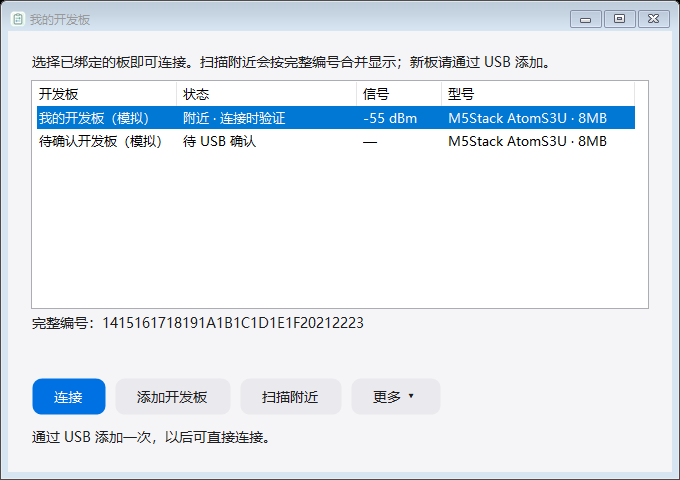
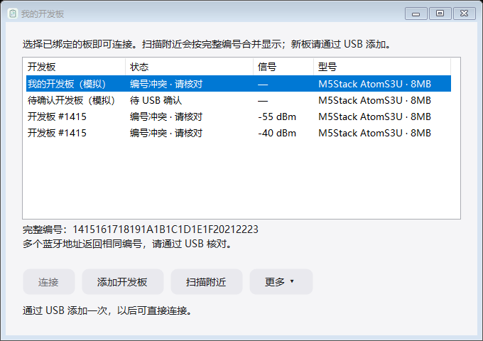
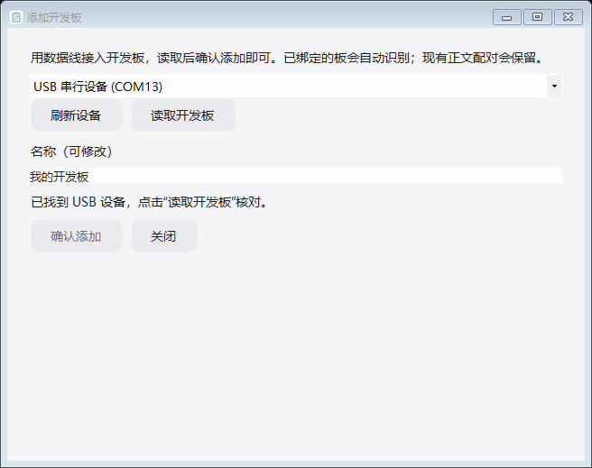
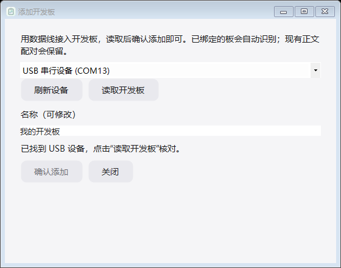

# Windows 0.2.1 界面检查

2026-10-19。使用最终构建的真实 WinForms 控件，离屏渲染默认及最小窗口。测试采用独立目录、合成密钥和标注为模拟的开发板记录；没有调用 BLE 扫描、串口读取或用户配置。与桌面截图不同，这是控件渲染证据，不代表实机蓝牙验证。

## 统一开发板列表

完整编号一致的绑定和广播仅一行，状态和信号靠前，选中后的 32 位完整编号显示在下方。主要操作只保留连接、添加、扫描和更多。已确认且无冲突才能连接；待确认和冲突记录禁止直接连接。

最小窗口 680×480：四列和操作按钮均可见，完整编号未省略。

两个地址返回同一完整编号时保留冲突，避免默默选择其中一个。

## USB 添加

直接显示设备、读取操作和可修改的名称，取消迁移复选框。未读取完整 Info 时确认按钮禁用。以下 USB 串口名称来自系统枚举，没有打开该串口。

BoardManagementTests 的 17 项检查通过。Android 真机、大字体、多 DPI、辅助技术及真实 USB / BLE 操作未由本渲染测试覆盖。0.2.0 烧录页等历史证据见 [WINDOWS_UI_REVIEW_020.md](WINDOWS_UI_REVIEW_020.md)。
