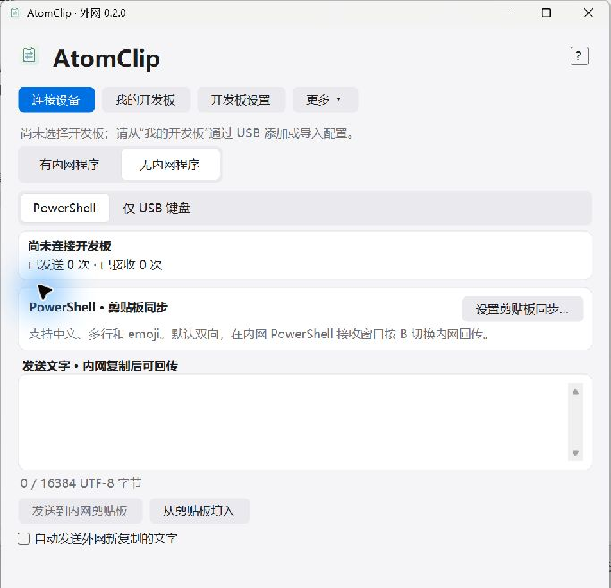
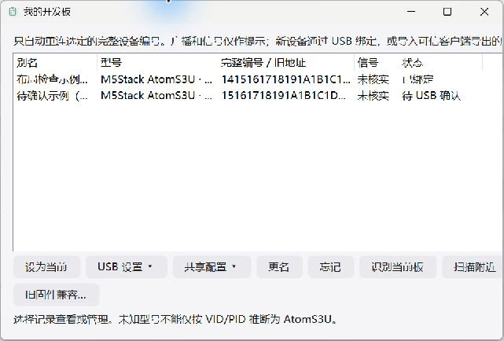
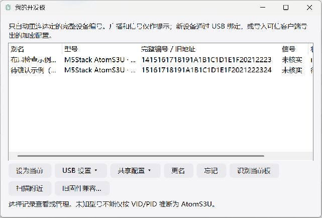
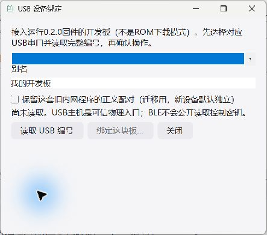
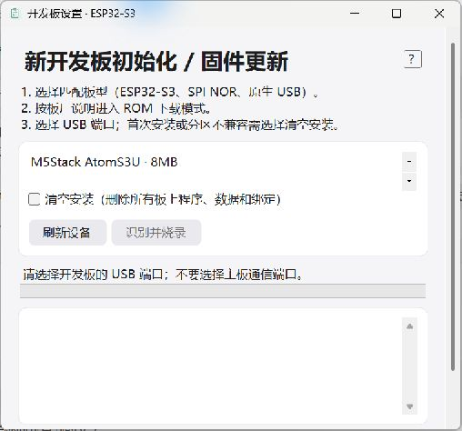
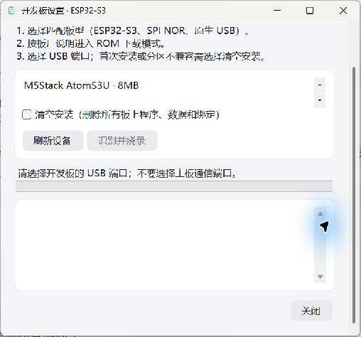

# Windows 0.2.0 界面检查

2026-10-17，真实已构建 WinForms 界面，使用独立目录与两个模拟设备记录。未访问用户绑定库、扫描 BLE、打开串口或烧录。截图来自本次 Windows Computer Use；保留程序原有 DPI 设置。

1. **主界面入口：可用。**“我的开发板”和“开发板设置”可打开对应界面，未绑定时保持未连接。

2. **我的开发板：发现问题并修复。** 原来表格列宽不受窗口约束，顶部提示与右侧操作被裁切；固定编号列宽使 32 位编号显示省略号。添加百分比列宽后，提示和按钮自动换行，编号列按字体测量，列表可水平滚动；长别名另有完整工具提示。默认窗口中状态列需要横向滚动，不应把当前局部显示当作完整列表。

3. **USB 绑定：可用。** 表单按内容高度布局，外层支持滚动；说明、别名、旧配对迁移选项和三个按钮可见，未读取板卡时绑定禁用。本次没有真实 USB 端口，未执行读取 / 写入。

4. **烧录设置：可用。** 板型、端口、明确清空选项、状态和进度分开显示；无端口时烧录禁用。底部“关闭”通过滚动可到达，没有被不可滚动的容器永久裁掉。没有执行真实烧录。

边界：本次检查默认桌面环境和上述状态，未穷尽最小窗口、多 DPI、大字号和屏幕阅读器。部分原生组合框的辅助技术名称继承了相邻说明，仍有精简标签的改进空间；不宣称完整无障碍合规。Android 没有手机 / 模拟器，修复后的原生布局未在此报告中模拟或冒充实机截图。
